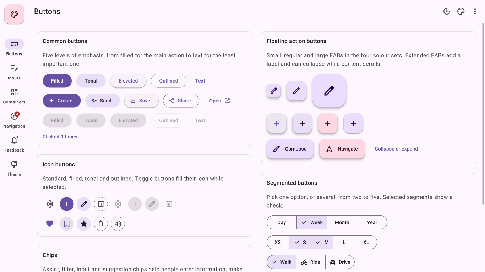
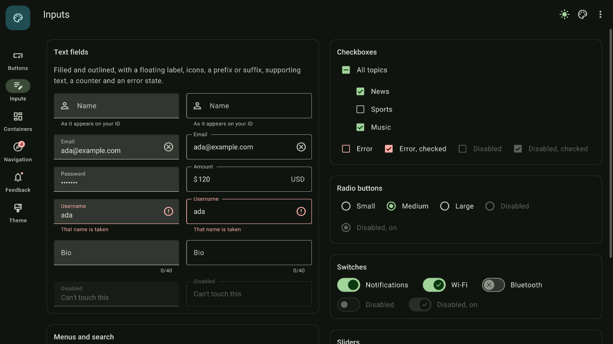
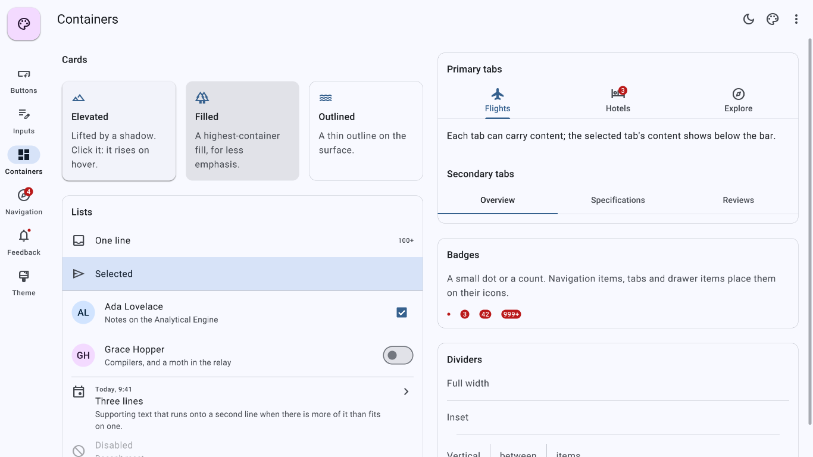
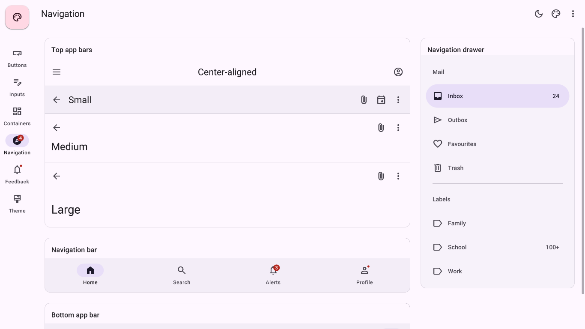
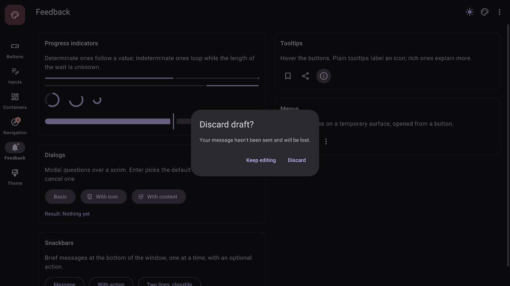
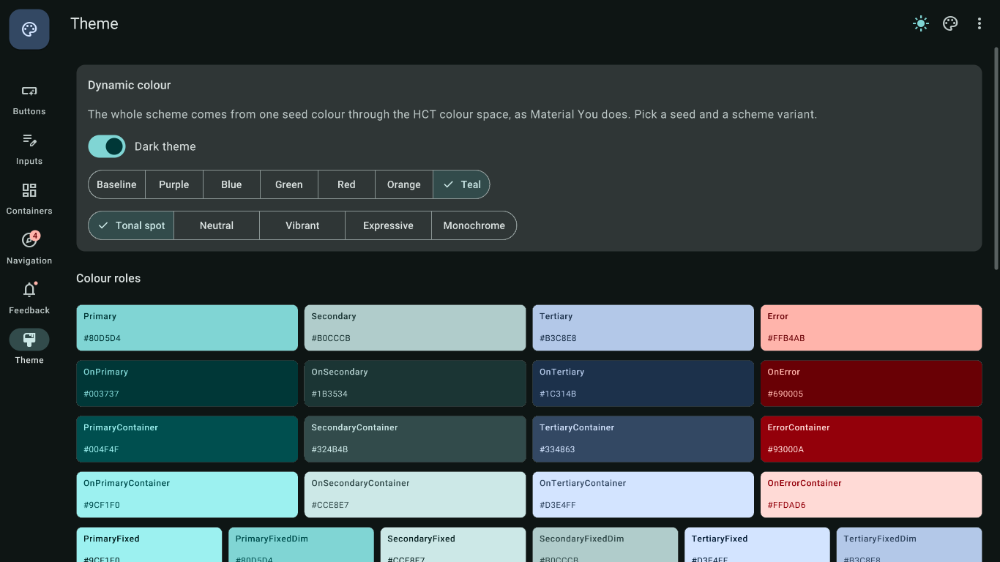

# osu-xaml-material-3

[osu-xaml](https://github.com/614project/osu-xaml) 위에서 쓰는 **Material Design 3** 컨트롤 라이브러리입니다.
색 체계(HCT 기반 동적 색), 타이포그래피, 모양, 고도(그림자), 상태 레이어와 리플, 모션까지 Material 3 사양을 최대한 그대로 옮겼습니다.
XAML에서 osu-xaml의 패널(`Grid`, `StackPanel`, `WrapPanel` …)과 함께 쓰고, 바인딩도 osu-xaml과 같습니다.



| | |
|---|---|
|  |  |
|  |  |

## 시작하기

### 1. 가져오기

osu-xaml은 git 서브모듈(`external/osu-xaml`)로 들어 있습니다.

```bash
git clone --recursive https://github.com/614project/osu-xaml-material-3.git
# 이미 받아 두었다면
git submodule update --init
```

앱 프로젝트에서 라이브러리와 osu-xaml의 소스 생성기를 참조합니다. `samples/Material3Gallery/Material3Gallery.csproj`가 그대로 예시입니다.

```xml
<ItemGroup>
  <ProjectReference Include="..\osu-xaml-material-3\src\OsuXaml.Material3\OsuXaml.Material3.csproj" />
  <ProjectReference Include="..\osu-xaml-material-3\external\osu-xaml\src\OsuXaml.Generator\OsuXaml.Generator.csproj"
                    OutputItemType="Analyzer" ReferenceOutputAssembly="false" />
</ItemGroup>
<ItemGroup>
  <AdditionalFiles Include="**\*.xaml" />
</ItemGroup>
```

osu!framework 버전은 서브모듈의 osu-xaml과 같은 `2026.1008.0`이며 `Directory.Build.props`에 있습니다.

### 2. 게임 설정

```csharp
using OsuXaml.Material3;

public partial class MyGame : Game
{
    [BackgroundDependencyLoader]
    private void load()
    {
        // Roboto Medium과 Material Symbols(Outlined, Filled) 폰트를 등록합니다. 컴포넌트를 만들기 전에 한 번.
        this.AddMaterial3();

        // 선택: 시드 색에서 스킴을 만들고, osu-xaml 기본 컨트롤(스크롤 바 등)의 색도 맞춥니다.
        MaterialTheme.Default.SeedColor.Value = Colour4.FromHex("0061A4");
        MaterialTheme.Default.Scheme.Value.ApplyToOsuXamlTheme();

        Add(new MainWindow());
    }
}
```

### 3. XAML

`xmlns:m3="clr-namespace:OsuXaml.Material3"`를 선언하고, 화면을 `m3:ThemeScope`로 감싸면 배경이 Surface 색으로 칠해집니다.

```xml
<Window xmlns="osu-xaml" xmlns:x="osu-xaml:x" xmlns:m3="clr-namespace:OsuXaml.Material3"
        xmlns:local="clr-namespace:App"
        x:Class="App.MainWindow" x:DataType="local:SettingsViewModel">
  <m3:ThemeScope>
    <StackPanel Padding="24" Spacing="16">
      <m3:Text TypeStyle="HeadlineSmall" Text="Settings" />
      <m3:TextField Label="Name" Text="{Bind Name}" LeadingIcon="Person" SupportingText="As it appears on your ID" />
      <m3:Switch Text="Notifications" IsChecked="{Bind Notifications}" />
      <m3:Slider Value="{Bind Volume}" StepSize="10" />
      <StackPanel Orientation="Horizontal" Spacing="8">
        <m3:TextButton Text="Cancel" />
        <m3:FilledButton Icon="Check" Text="Save" Click="{Bind Save}" PlainTooltip="Save the settings" />
      </StackPanel>
    </StackPanel>
  </m3:ThemeScope>
</Window>
```

## 컴포넌트

| 분류 | 컨트롤 |
|---|---|
| 버튼 | `FilledButton`, `FilledTonalButton`, `ElevatedButton`, `OutlinedButton`, `TextButton`, `IconButton`(Standard·Filled·FilledTonal·Outlined, 토글), `Fab`(Small·Regular·Large, Primary·Surface·Secondary·Tertiary), `ExtendedFab`(접고 펼치기), `SegmentedButton` + `Segment`(단일·다중 선택) |
| 선택 | `Checkbox`(3상태, 오류), `RadioButton`(`GroupName`), `Switch`(핸들 아이콘), `Slider`(연속·단계, 눈금, 드래그 중 값 라벨) |
| 입력 | `TextField`(Filled·Outlined, 떠오르는 라벨, 앞뒤 아이콘, 접두·접미사, 보조 문구, 글자 수, 오류, 비밀번호), `DropdownField`, `SearchBar` |
| 칩 | `AssistChip`, `FilterChip`, `InputChip`(제거 버튼), `SuggestionChip` |
| 컨테이너 | `Surface`, `Card`(Elevated·Filled·Outlined, 클릭), `ListItem`(1~3줄, 앞뒤 요소), `Avatar`, `Divider`, `Badge` |
| 내비게이션 | `TopAppBar`(Small·CenterAligned·Medium·Large, 스크롤 상태), `BottomAppBar`, `NavigationBar`, `NavigationRail`, `NavigationDrawer`, `Tabs`(Primary·Secondary, 탭마다 내용) |
| 피드백 | `LinearProgressIndicator`, `CircularProgressIndicator`(확정·불확정), `AlertDialog`, `SnackbarHost`, `Menu` + `MenuItem`(버튼의 `Menu` 속성), 툴팁(`PlainTooltip` 속성, `RichTooltip`) |
| 기반 | `Text`(타입 스케일), `Icon`(Material Symbols 4,004개, Outlined·Filled), `ThemeScope`, `StateLayer`, `ElevationShadow` |

모든 컴포넌트는 osu-xaml 레이아웃 요소라서 패널 안에서 크기를 재고 정렬됩니다. 버튼처럼 내용에 맞는 컨트롤은 기본이 왼쪽 정렬이고, `HorizontalAlignment="Stretch"`로 늘릴 수 있습니다.

### 자주 쓰는 형태

```xml
<!-- 버튼에 메뉴 달기 -->
<m3:IconButton Icon="MoreVert">
  <m3:IconButton.Menu>
    <m3:Menu ItemClicked="OnMenuItem">
      <m3:MenuItem Text="Cut" LeadingIcon="ContentCut" TrailingText="Ctrl+X" />
      <m3:Divider />
      <m3:MenuItem Text="Select all" LeadingIcon="SelectAll" />
    </m3:Menu>
  </m3:IconButton.Menu>
</m3:IconButton>

<!-- 탭마다 내용 -->
<m3:Tabs SelectedIndex="{Bind Tab}">
  <m3:Tab Icon="Flight" Text="Flights"><local:FlightsView /></m3:Tab>
  <m3:Tab Icon="Hotel" Text="Hotels" BadgeText="3"><local:HotelsView /></m3:Tab>
</m3:Tabs>

<!-- 리치 툴팁 -->
<m3:IconButton Icon="Info">
  <ToolTipService.ToolTip>
    <m3:RichTooltip Subhead="Backups" SupportingText="Saved every night at 2am." />
  </ToolTipService.ToolTip>
</m3:IconButton>
```

```csharp
// 다이얼로그: Enter는 확인, Escape는 취소. 결과는 Task로 받습니다.
bool? delete = await AlertDialog.Show(this, "Delete draft?", "It can't be undone.", "Delete", "Cancel", Symbol.Delete);

// 스낵바: 화면을 <m3:SnackbarHost>로 감싸 두고 그 안 어디서든.
SnackbarHost.Find(this)?.Show("Conversation archived", "Undo", undoArchive);
```

직접 만든 다이얼로그는 `m3:AlertDialog`를 루트로 하는 XAML(`x:Class`)로 만들고 `await new MyDialog().ShowDialog(this)`로 띄웁니다. `samples/Material3Gallery/Dialogs/RingtoneDialog.xaml`이 예시입니다.

## 테마



- **`MaterialTheme.Default`** 가 앱 전체 테마입니다. `IsDark`, `SeedColor`(null이면 Material의 기본 보라색 스킴), `Variant`(TonalSpot·Neutral·Vibrant·Expressive·Monochrome)를 바꾸면 모든 컴포넌트가 새 색으로 부드럽게 바뀝니다.
- 색은 Material의 색 역할(`ColorRole`) 49개입니다. `ColorScheme.FromSeed(seed, dark, variant)`는 HCT 색 공간(CAM16 + L\*)에서 톤 팔레트를 만듭니다. material-color-utilities의 HCT 솔버를 그대로 옮겨서 톤 팔레트가 Material Theme Builder·Android와 비트 단위로 같습니다(테스트로 확인합니다).
- **`<m3:ThemeScope IsDark="True" SeedColor="#006A6A">`** 는 그 안만 다른 테마로 그립니다. 정하지 않은 값은 바깥 테마를 따릅니다.
- 메뉴, 다이얼로그, 툴팁은 창의 팝업 레이어에 뜨지만, 자신을 띄운 요소의 테마를 따릅니다(`MaterialTheme.Of(element)`).
- XAML에서 역할 쓰기: `<m3:Text ColorRole="Primary">`, `<m3:Icon ColorRole="Tertiary">`, `<m3:Surface Role="PrimaryContainer">`(안의 글자는 자동으로 OnPrimaryContainer). 코드에서는 `MaterialTheme.Of(this).Scheme.Value.Primary`.

### 타이포그래피, 모양, 고도, 모션

| | |
|---|---|
| 타입 스케일 | `TypeStyle` 15종(DisplayLarge … LabelSmall). 크기, 줄 높이, 굵기, 자간이 사양대로입니다. Roboto Regular는 osu!framework 것을, Medium은 이 라이브러리에 든 것을 씁니다. |
| 모양 | `ShapeCorner`: None, ExtraSmall(4), Small(8), Medium(12), Large(16), ExtraLarge(28), Full |
| 고도 | 0~5단계. Material처럼 그림자 두 겹(key, ambient)으로 그리고, 마우스를 올리면 한 단계 오르는 컴포넌트도 있습니다. |
| 상태 레이어 | hover 8%, focus·press 10%, drag 16%, 누른 자리에서 퍼지는 리플. 비활성은 컨테이너 12%, 내용 38%. |
| 모션 | `Motion.Short1` ~ `ExtraLong4`(50~1000ms), `Standard`·`Emphasized` 계열 이징 |

## 갤러리 실행

```bash
dotnet run --project samples/Material3Gallery
# 페이지(0~5), 다크 테마, 시드 색(0~5), 변형(0~4)을 골라서 시작
dotnet run --project samples/Material3Gallery -- --page 1 --dark --seed 2 --variant 3
```

왼쪽 레일로 Buttons, Inputs, Containers, Navigation, Feedback, Theme 페이지를 오가고, 앱 바의 버튼으로 다크 테마, 시드 색, 스킴 변형을 바꿀 수 있습니다.

## 테스트

```bash
dotnet test
```

HCT·톤 팔레트를 material-color-utilities의 기준값과 비교하고, 모든 시드·변형·밝기에서 글자 색 대비가 4.5:1 이상인지 확인합니다. 컨트롤은 osu!framework의 헤드리스 테스트로 실제 입력(클릭, 드래그, 키)을 보내 동작과 크기를 확인하고, 갤러리의 모든 페이지를 불러 봅니다.

## 폰트와 도구

- `Resources/Fonts`: Roboto Medium(SIL OFL 1.1)과 Material Symbols Outlined·Filled(Apache 2.0)를 osu!framework 비트맵 폰트로 바꾼 것입니다. 라이선스 파일이 같은 폴더에 있습니다.
- `tools/fonts/make_bmfont.py`: TTF에서 비트맵 폰트를 만듭니다.
- `tools/fonts/make_symbols.py`: Material Symbols 폰트와 `material-symbols.tsv`에서 `Symbol` 열거형(Jetpack Compose와 같은 이름)을 만듭니다.

## 제한 사항

- `TextField`는 한 줄 입력만 지원합니다. osu-xaml의 여러 줄 `TextBox`가 내부 글꼴을 따로 써서 Material 타입 스케일을 맞출 수 없기 때문입니다.
- 모달 뒤 스크림은 osu-xaml의 것(검정 50%)이라 Material의 32%보다 조금 어둡습니다.
- osu!framework의 마스킹은 둥근 모서리를 겹쳐 적용하지 못합니다. 둥근 `Card`나 `Surface` 안에 자체 마스킹을 쓰는 요소를 가장자리에 붙이면 바깥 모서리가 각질 수 있습니다(라이브러리 컴포넌트는 이를 피해서 그립니다).
- 리치 툴팁은 osu-xaml 툴팁처럼 마우스를 올린 동안만 보이고, 안의 버튼을 누를 수 없습니다.
- 아직 없는 컴포넌트: 바텀·사이드 시트, 날짜·시간 선택기, 캐러셀, 범위 슬라이더, 전체 화면 검색 뷰, 그리고 2025년 Material 3 Expressive에서 추가된 컴포넌트(버튼 그룹, 스플릿 버튼, 툴바, 로딩 인디케이터 등).
